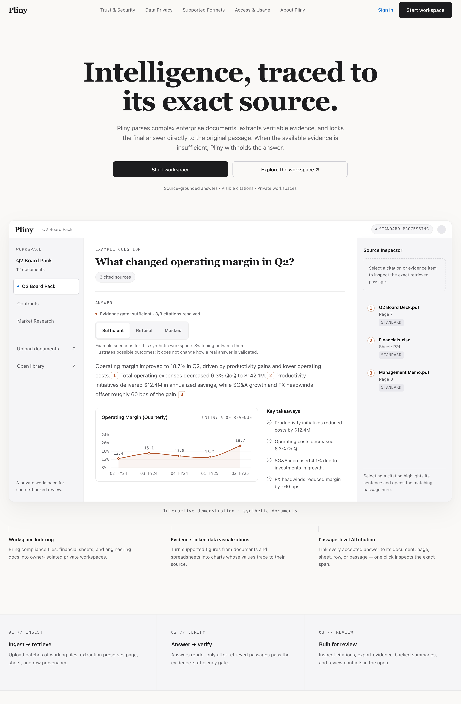
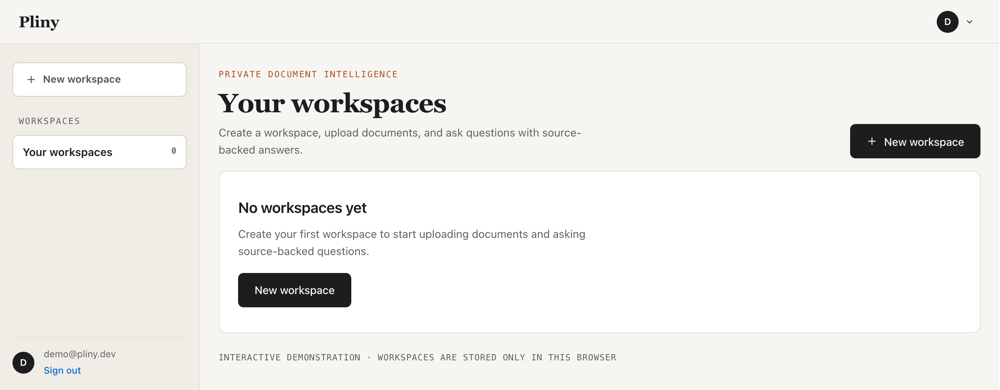
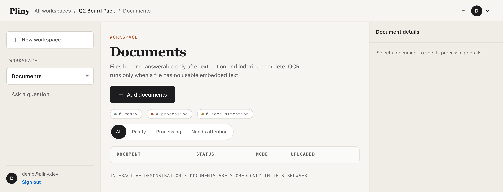

# Pliny

**Intelligence, traced to its exact source.**

Pliny turns a collection of documents into a workspace you can question, inspect and review. Bring in PDFs, spreadsheets or working notes, ask what you need to know, and follow the answer back to the passage it cites.

The aim is simple: spend less time searching through files without giving up the ability to check the answer yourself.

[Open Pliny](https://pliny.vercel.app/) · [Architecture](./docs/architecture.md) · [Security & privacy](./docs/security-and-privacy.md) · [Evaluation](./docs/evaluation.md)

*Images in this README come from Pliny's original interface prototypes and use illustrative data. They show the design direction, not live retrieval results; the deployed application has since evolved.*

## A workspace for the question—and its evidence

A useful answer should be easy to read and possible to challenge. Pliny keeps the question, answer and supporting sources within the same review flow. Open a citation to see the retrieved passage and its document location. If the evidence is insufficient, the answer path returns an explicit refusal.

This makes it useful for checking a clause in a contract, finding a record in a spreadsheet, or comparing information across a set of working documents. The source remains part of the task, rather than a footnote you have to chase later.

## What you can do

- Organise documents in private workspaces, with Standard or privacy-minimised processing.
- Upload PDF, DOCX, XLSX, CSV, HTML, Markdown and TXT files. Inspect processing status and document details, retry failures, and remove individual files.
- Ask across a workspace or narrow the question to selected documents. Revisit previous questions and inspect the cited passages.
- Review evidence-linked charts and Risk and Evidence Reports where the answer supports them.
- Copy an answer, export a selected answer as Markdown, print or save it as PDF through the browser, or export the conversation transcript.

## Interface design

The interface uses restrained typography, quiet surfaces and a clear separation between navigation, reading and source inspection. Its purpose is to make document review easier to follow, not to make the evidence compete with the interface.

Workspace organisation

Document library and processing

## How it works

Pliny is built with TypeScript, Next.js and React. Supabase provides authentication, PostgreSQL and private file storage; pgvector supports semantic retrieval, and Tesseract provides the OCR fallback for scanned PDFs.

The document pipeline extracts text, creates format-aware chunks and retains available page, sheet, row and heading references. Retrieval combines PostgreSQL full-text search with vector similarity using reciprocal rank fusion, with additional handling for structured identifiers. Evidence-sufficiency checks and citation validation constrain the answer path before the result is returned.

Privacy-minimised processing replaces supported sensitive identifiers with document-scoped pseudonyms before external processing. Workspace access is enforced through authentication, database row-level security and server-side ownership checks.

The repository includes deterministic regression tests, release evaluations and focused browser checks. These cover specific behaviours; they are not a claim that every document or question will succeed. The [evaluation notes](./docs/evaluation.md) describe what has been measured and what remains unverified.

For the implementation details, start with the [architecture guide](./docs/architecture.md).

## Current scope

Pliny is a working portfolio product with bounded file, extraction, indexing and OCR capacity. It is not an unrestricted document archive or a certified enterprise deployment. Shared workspaces, team roles, enterprise SSO and billing are not implemented.

Citations make an answer inspectable; they do not prove that a source is correct or that every relevant passage was retrieved. Privacy-minimised processing is not local-only processing and does not guarantee detection of every sensitive value.

Before using confidential material or evaluating a large corpus, read the [limitations](./docs/limitations.md) and [security and privacy notes](./docs/security-and-privacy.md).
